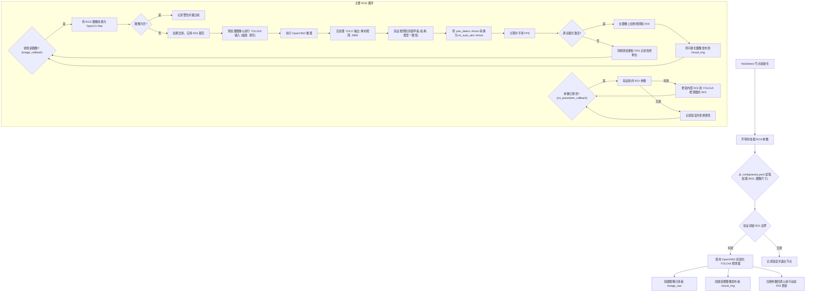

# yolo_detect 包 - 总体功能和工作流程

## 看前须知

本功能包基于[同济大学 SuperPower 战队 25 赛季自瞄算法开源](https://github.com/TongjiSuperPower/sp_vision_25.git)中/tasks/auto_aim 框架所改 仅移植 yolov5 及其 armor 部分 

通过部分适应性修改完成一下功能：

1. 成功移植 ros2 依赖，订阅海康相机发布的图像信息。

2. 仿照 RV debug 模式实现 /result_img 发布。

3. 支持定义 ROI 以将检测限制在图像的特定区域，ROI 参数可以动态更新。

4. 将内部 `yolo_detect::Armor` 结构转换为 `rm_auto_aim::Armor` 消息。

   注： `rm_auto_aim::Armor` 是 RV 的 armor 的数据类型 原本打算是为了完全复刻 RV 的 debug，后面懒得做了，就做到了这种地步。

   

   PS: 本文档为25.12.11所著

## 所需环境

安装依赖项：

- [MindVision SDK](https://mindvision.com.cn/category/software/sdk-installation-package/)或[HikRobot SDK](https://www.hikrobotics.com/cn2/source/support/software/MVS_STD_GML_V2.1.2_231116.zip)
- [OpenVINO](https://docs.openvino.ai/2024/get-started/install-openvino/install-openvino-archive-linux.html)
- [Ceres](http://ceres-solver.org/installation.html)
- 其余：

```
sudo apt install -y \
    git \
    g++ \
    cmake \
    can-utils \
    libopencv-dev \
    libfmt-dev \
    libeigen3-dev \
    libspdlog-dev \
    libyaml-cpp-dev \
    libusb-1.0-0-dev \
    nlohmann-json3-dev \
    openssh-server \
    screen
```

***PS: 上述为同济官网所需的环境，但理论上仅需安装 OpenVINO 和 海康相机 SDK 即可***

## 工作流程/流程图

以下流程图说明了 `yolo_detect` 节点的高级操作流程：



详细描述请看[yolo_detect_functions.md](yolo_detect_functions.md) 此文档由LLM大模型所著 注意辨明

